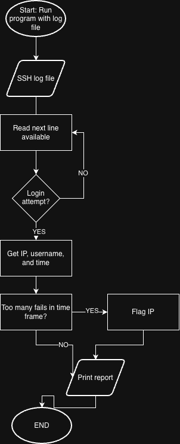

# SSH Brute-Force Log Analyzer

A Java command-line tool that finds brute-force login attacks in SSH server logs.

## The Problem
Servers get hit with automated login attempts constantly, but the evidence is buried in huge log files. I want to go into cybersecurity, so I'm building a tool to make those attacks easy to spot.

## MVP
- Read login attempts from an SSH log file
- Flag IPs with too many failed logins in a short time
- Print a report of flagged IPs

[Eisenhower Matrix](docs/Untitled%20document.pdf)

## Tech Stack
- Java
- Data: OpenSSH logs from [Loghub](https://github.com/logpai/loghub)

## Setup & Usage
Coming once the MVP is built.

## Roadmap
- [ ] Alert when an IP fails many times, then logs in successfully
- [ ] Check attempted passwords against Have I Been Pwned
- [ ] Swing UI

## Author
Max Govan, [@Maxwell-Govan](https://github.com/Maxwell-Govan)
